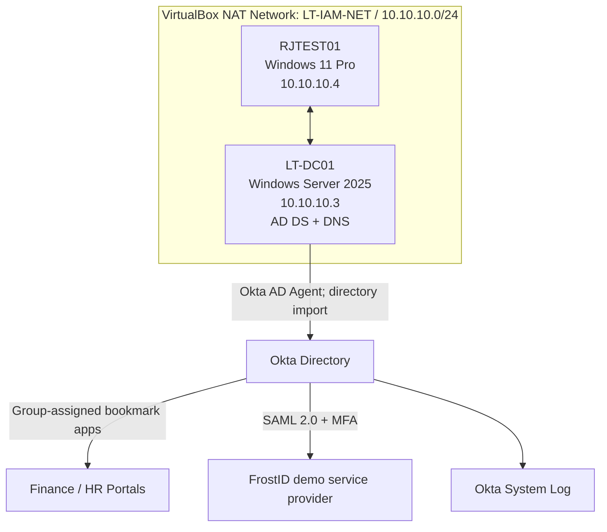

# LightTech IAM Architecture

## Topology

- **Directory source:** AD domain `lab.lighttech.internal` (NetBIOS: `LIGHTTECH`).
- **Imports:** Okta AD Agent connected; user/group imports used for provisioning and group membership changes; an hourly import schedule was configured.
- **Groups:** `LT-Finance-Users`, `LT-HR-Users`, `LT-IT-Administrators`, `LT-IT-Helpdesk`.
- **Applications:** Finance Portal and HR Portal are Okta bookmark applications, using a placeholder URL. They validate **assignment and visibility**, not application-side permissions.
- **Federation:** Okta is the SAML identity provider (IdP); FrostID is a SAML service provider (SP).
- **Audit:** Okta System Log supports event searches and validation of lifecycle and sign-on activities.

## Trust boundaries

1. AD is the test identity and group source for directory import.
2. Okta stores imported directory identities, evaluates authentication and application assignment policies, and records System Log events.
3. FrostID validates a SAML response for the **SP-initiated** flow tested here.
4. The bookmark demo apps are not protected resource servers; no data-plane authorization has been proven.

See [SAML flow](saml-flow.md) and [environment details](../docs/01-environment.md).
