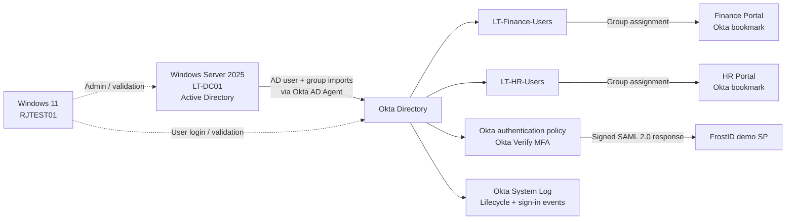
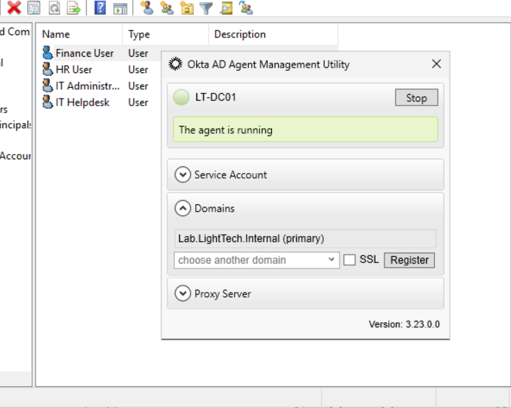
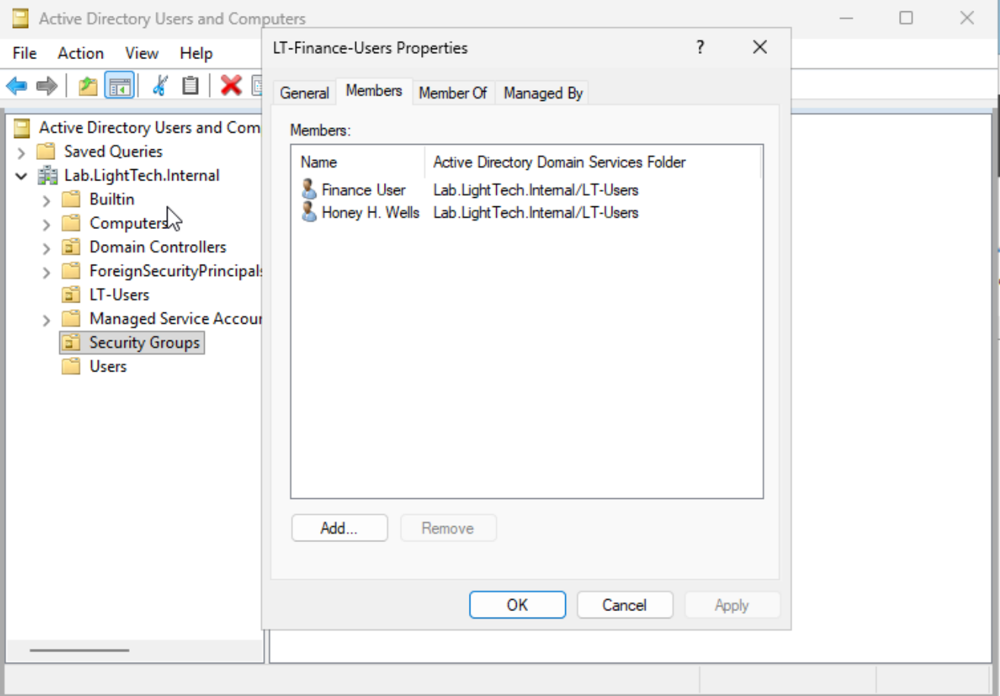
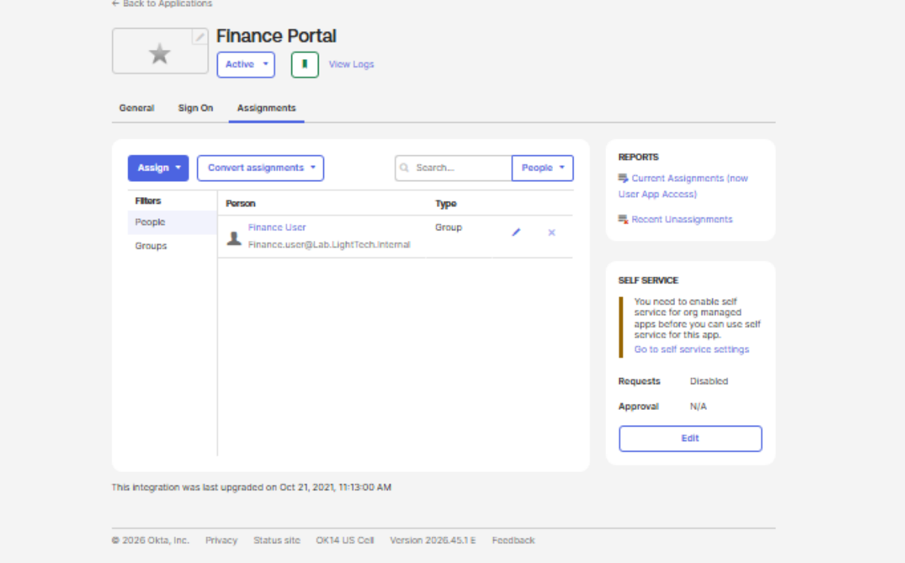
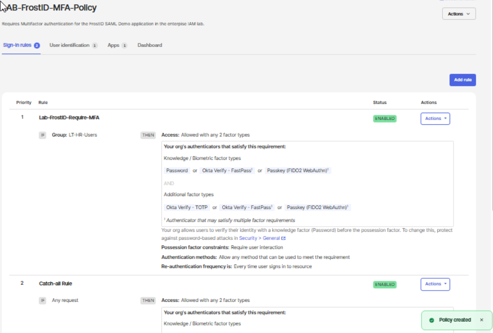
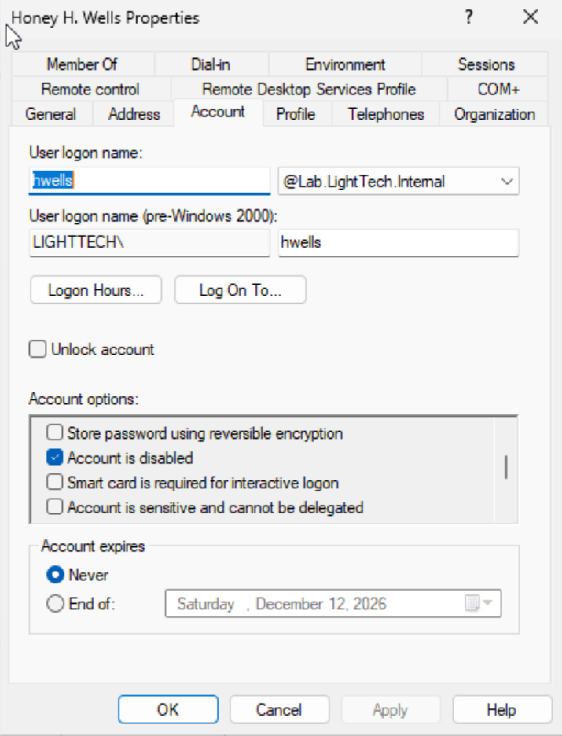

# LightTech Enterprise IAM Lab

**Active Directory → Okta | Identity lifecycle (JML) | Group-based access | SAML 2.0 SSO | MFA | Access reviews | Audit monitoring**

A hands-on identity and access management portfolio project built in an isolated Windows Server / Windows 11 virtual lab. This repository documents an **end-to-end identity lifecycle**: create an employee in Active Directory, import the identity into Okta, grant application access through role-aligned groups, change access during a department transfer, and validate deprovisioning and audit events during offboarding.

> **Lab scope:** Simulated employees and applications; no production identities. `Finance Portal` and `HR Portal` are **Okta bookmark application demonstrations**, not genuine finance/HR systems. Their dashboard visibility shows Okta assignment behavior, **not authorization enforcement inside an external application**.

## At a glance

| Focus | Demonstrated result | Evidence |
|---|---|---|
| AD → Okta integration | AD agent connected; lab users/groups imported | [Directory integration](docs/02-directory-integration.md) |
| Joiner | Honey H. Wells onboarded and assigned Finance access | [JML walkthrough](docs/03-joiner-mover-leaver.md) |
| Mover | Finance access removed; HR access assigned | [JML walkthrough](docs/03-joiner-mover-leaver.md) |
| Leaver | AD account disabled, Okta account deactivated; access removal and session events logged | [Offboarding audit](audit-reports/offboarding-audit.md) |
| RBAC / least privilege | Department groups control bookmark application assignments | [RBAC tests](docs/04-rbac-application-access.md) |
| Federation | FrostID demo SP accepts SP-initiated SAML authentication | [SAML and MFA](docs/05-saml-and-mfa.md) |
| MFA | Dedicated FrostID authentication policy and Okta Verify successful MFA | [MFA audit](audit-reports/authentication-mfa-audit.md) |
| Governance | Manual access review; intentional direct-assignment violation remediated | [Access review](audit-reports/access-review.md) |
| Audit | Okta System Log event analysis for offboarding and authentication | [Audit procedures](docs/07-audit-monitoring.md) |

## Environment

| Component | Configuration |
|---|---|
| Hypervisor | Oracle VirtualBox |
| Domain controller | Windows Server 2025, `LT-DC01`, `10.10.10.3` |
| Client | Windows 11 Pro, `RJTEST01`, `10.10.10.4` |
| AD domain | `lab.lighttech.internal` (`LIGHTTECH`) |
| Network | Isolated VirtualBox NAT Network `LT-IAM-NET` (`10.10.10.0/24`) |
| Identity provider | Okta with Active Directory Agent |
| SAML service provider | FrostID SAML Demo / sandbox service provider |
| MFA | Okta Verify (tested against a dedicated application authentication policy) |

### Architecture



[Architecture details](architecture/README.md) · [Authentication flow](architecture/saml-flow.md)

## Tested scenarios

1. **Joiner:** Created Honey H. Wells (`hwells`) in AD, added Finance group membership, imported the identity into Okta, and verified the Finance Portal assignment.
2. **Mover:** Changed department membership from Finance to HR, synchronized the directory, and verified the corresponding portal visibility change.
3. **Leaver:** Disabled the AD account, confirmed Okta deactivation, investigated removal of **both** Finance and HR application memberships, and reviewed session-clearing and import-triggered lifecycle events.
4. **Access review:** Confirmed `finance.user` remained in `LT-Finance-Users`, `hr.user` remained in `LT-HR-Users`, and the leaver stayed deactivated.
5. **Governance remediation:** Intentionally assigned `hr.user` directly to Finance Portal (outside the authorized group), detected it during review, then removed the direct assignment without affecting legitimate Finance or HR access.
6. **SAML + MFA:** Validated FrostID IdP metadata, tested SP-initiated SAML SSO, enforced Okta Verify MFA, and checked System Log results.

### Selected evidence

| Directory sync | Joiner | Access remediation |
|---|---|---|
|  |  |  |

| MFA policy | Successful SAML login | Deactivation |
|---|---|---|
|  |  |  |

All available **public-safe screenshots** are indexed in [Evidence Catalog](docs/09-evidence-catalog.md). Selected images are cropped or redacted; raw SAML transaction/metadata screenshots from the source archive are deliberately excluded.

## Key technical decisions and limitations

- **Authorization is not the same as assignment.** The two department portals are bookmarks; the test verifies Okta assignment/visibility, not application-side RBAC.
- **SP-initiated SSO succeeded.** Opening FrostID directly from the Okta dashboard resulted in an `InResponseTo` error. Starting via FrostID's **Run Test Login** completed successfully. This is documented as a flow-compatibility observation, not a claim that every SAML launch type works.
- **Deactivation is not permanent deletion.** Okta logged a successful **“Delete user triggered by import process”** event, but Honey's profile remained **Deactivated** on a subsequent check. We do not claim permanent deletion.
- **Session log limits.** A successful session-clearing event demonstrates Okta handled that operation; it does not prove every downstream app session was revoked.
- **Access reviews were lab decisions.** No independent application owner attested access; this is a simulated manual certification exercise, not Okta Identity Governance's automated review feature.
- **No Microsoft 365 integration** was used in this lab.

## Repository contents

```text
LightTech Enterprise IAM Lab/
├── README.md
├── architecture/               # Architecture and SAML flow diagrams
├── docs/                       # Build, JML, RBAC, SAML, governance, audits
├── audit-reports/              # Access review, offboarding, MFA audit records
│   └── source-notes/           # Original lab audit text files
├── screenshots/                # Curated public-safe evidence by workflow
├── SECURITY.md                 # Evidence-handling and redaction policy
├── LICENSE
└── PUBLISH_TO_GITHUB.md        # Upload instructions
```

## Skills demonstrated

**Active Directory** · **Okta Administration** · **Joiner/Mover/Leaver (JML)** · **Identity Lifecycle Management** · **RBAC** · **Least Privilege** · **SAML 2.0 SSO** · **Okta Verify MFA** · **Application Sign-on Policy** · **Access Reviews** · **Deprovisioning** · **Audit Analysis** · **System Log Investigation** · **Technical Documentation**

## How to review this project

Start with the [architecture](architecture/README.md), read the [JML test narrative](docs/03-joiner-mover-leaver.md), inspect the [governance finding](audit-reports/access-review.md), and finish with the [offboarding audit](audit-reports/offboarding-audit.md) and [authentication audit](audit-reports/authentication-mfa-audit.md).

**Context:** This is a learning and portfolio lab. Findings describe observed behavior in an isolated environment and should not be interpreted as enterprise control certification.
