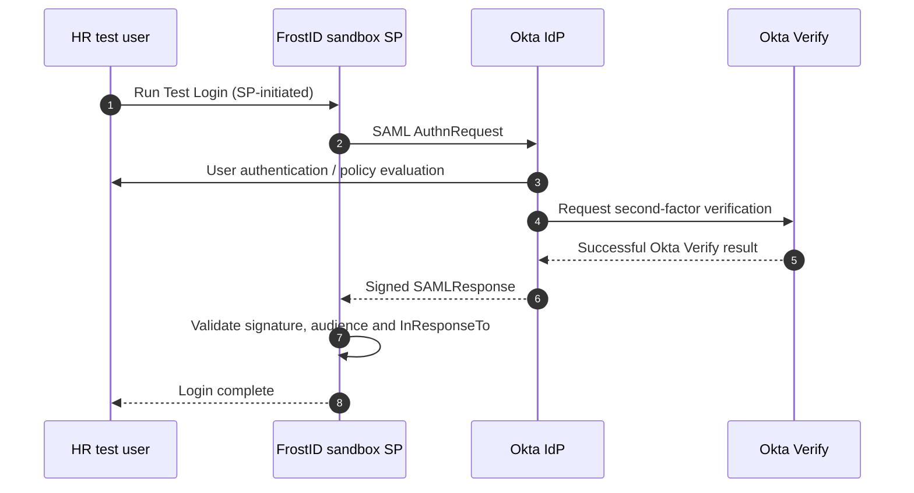

# SAML 2.0 SSO and MFA Flow

**Configuration observed:** FrostID service provider ACS `https://sandbox-sp.frostid.se/acs`, audience `https://sandbox-sp.frostid.se`; policy `LAB-FrostID-MFA-Policy`; rule `LAB-FrostID-Require-MFA`; scoped to `LT-HR-Users`.

**Result:** The FrostID-initiated login completed, and Okta System Log showed successful Okta Verify MFA. Launching from the Okta end-user application tile produced an `InResponseTo` error at the SP. The successful test does **not** establish IdP-initiated compatibility.

**Evidence:** [SAML and MFA walkthrough](../docs/05-saml-and-mfa.md) · [MFA audit](../audit-reports/authentication-mfa-audit.md)
