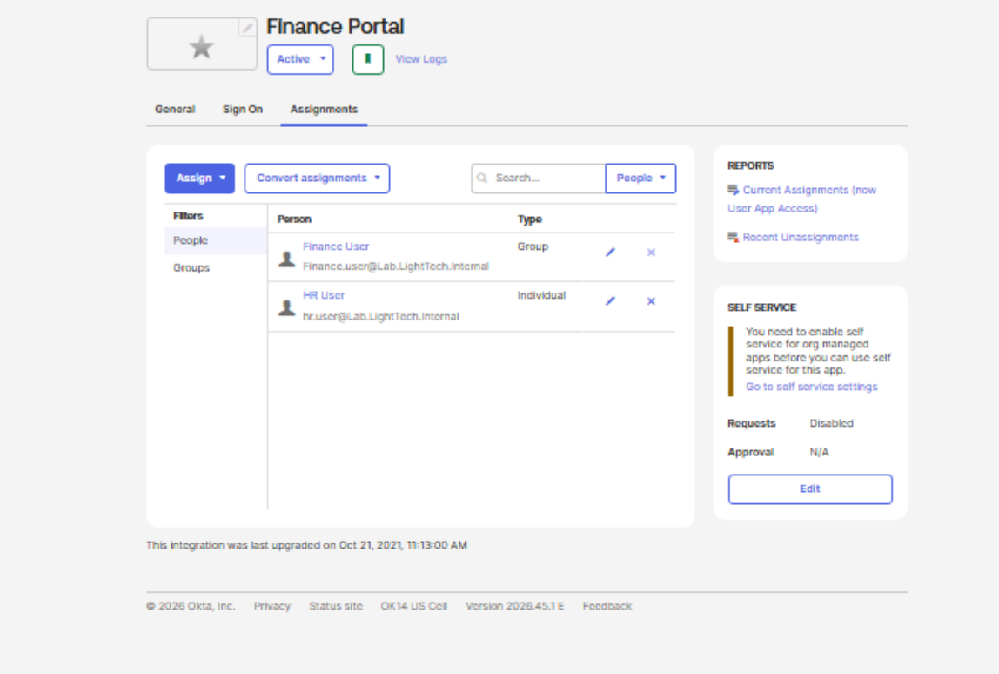
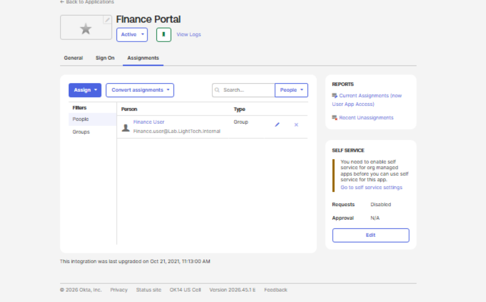

# Access Review and Remediation Record

| Field | Value |
|---|---|
| Project | LightTech Enterprise IAM Lab |
| Review | Manual Finance/HR group and app-access review |
| Platform | AD + Okta |
| Status | Completed — simulated exception resolved |
| Business-owner attestation | Not performed; test policy baseline only |

## Baseline decisions

| Identity | Group | Application | Decision | Basis |
|---|---|---|---|---|
| `finance.user` | `LT-Finance-Users` | Finance Portal | **Retain** | Matches Finance role |
| `hr.user` | `LT-HR-Users` | HR Portal | **Retain** | Matches HR role |
| Honey H. Wells | No active Finance/HR app assignment | None | **Remain deactivated** | Leaver verification |

**Initial review:** No unexpected group memberships or application assignments were identified at that time.

## Controlled remediation scenario — LT-IAM-001

**Finding type:** Unauthorized direct application assignment (simulated).

**Scenario:** `hr.user` was intentionally granted Finance Portal directly without membership in `LT-Finance-Users`, violating the lab's group-based access policy.

**Investigation:** Confirmed `hr.user` appeared as an application assignee while absent from the authorized Finance group.

**Remediation:** Removed the direct Finance Portal assignment; left Finance group assignment unchanged.

**Post-remediation checks:**

- `finance.user` retained Finance Portal.
- `hr.user` was no longer assigned to Finance Portal.
- `hr.user` retained HR Portal through `LT-HR-Users`.

**Status:** Resolved. **Environment:** Simulated home lab. **Production impact:** None.

