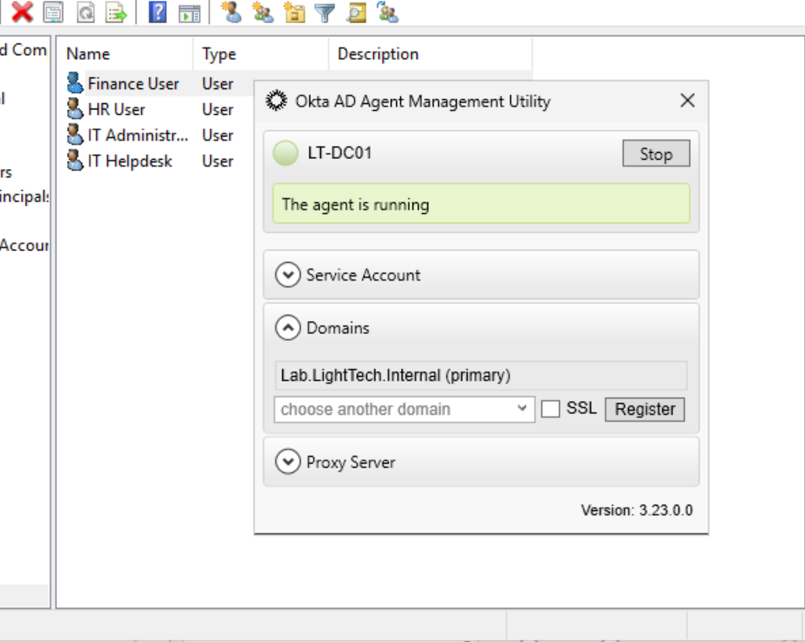
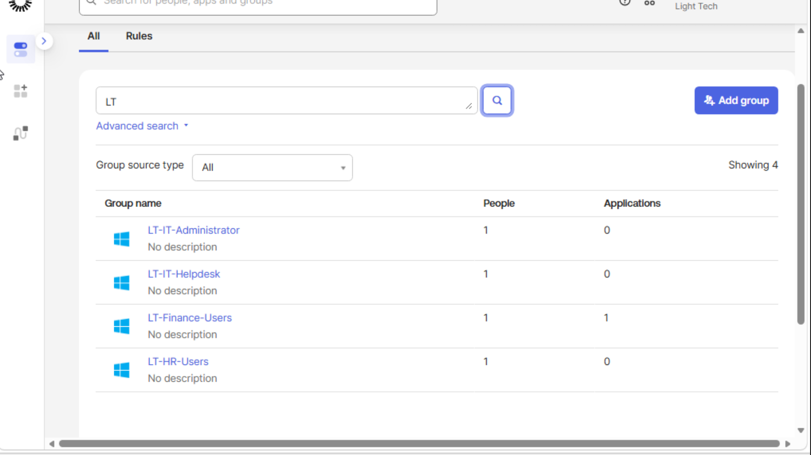
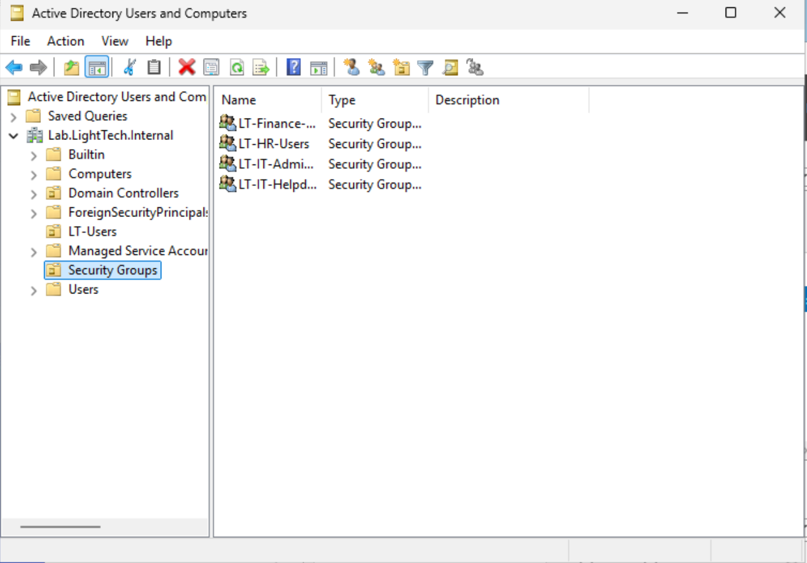

# 02 — Active Directory to Okta Integration

## Implementation summary

1. Built `lab.lighttech.internal` on Windows Server 2025 with AD DS and DNS.
2. Created department security groups with the **`LT-` prefix**.
3. Installed and connected the Okta AD Agent to the lab directory.
4. Imported AD identities and groups into Okta.
5. Configured **hourly import scheduling**; manually triggered imports during JML testing to validate changes quickly.
6. Verified imported users and group assignments in Okta Directory.

## Observed behavior

Okta displayed the connected AD agent and imported group data. Group changes made in AD were reflected in Okta after the associated import/synchronization actions.

**Limitations:** Imported identities/groups and lifecycle activity were demonstrated in this lab. No claim is made about fully automated SCIM provisioning into a production downstream application.

## Evidence

- 
- 
- 
